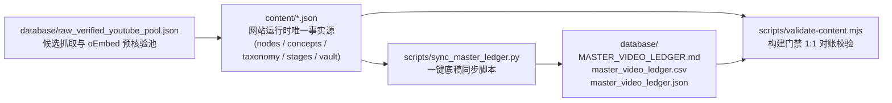

# `database/` — AITube 视频地址与多维标签底稿数据库（Ground-Truth Media & Tagging Database）

本目录是 **AITube** 的全量视频源链接、精确跳秒时间窗（`[startSec, endSec]`）、合规嵌入地址以及全维度打标数据的**统一底稿数据库（Ground-Truth Ledger）**，同时定义了每次发现、筛选、核验并引入新视频的标准规范。

---

## 1. 目录文件清单与职责

| 文件路径 | 格式 | 核心用途 |
| :--- | :--- | :--- |
| [`VIDEO_SOURCING_AND_INGESTION_SPEC.md`](VIDEO_SOURCING_AND_INGESTION_SPEC.md) | Markdown | **【必读规范】** 新视频查找策略、三级信源白名单、红线黑名单、可嵌入核验、黄金时间窗切片标准、讲人话文案准则与多维打标清单 |
| [`MASTER_VIDEO_LEDGER.md`](MASTER_VIDEO_LEDGER.md) | Markdown | **【可读底稿总表】** 全量 **280 条**节点的统计看板、概念/分面分布矩阵，以及包含可点击跳秒直达原链（`watch?v=...&t=...s` / `bilibili.com/.../?t=...`）的总表 |
| [`master_video_ledger.csv`](master_video_ledger.csv) | CSV (`UTF-8-BOM`) | **【表格底稿】** 含 36 个标准字段的平面宽表，可直接用 Excel / WPS 打开，或一键导入飞书多维表格、Notion Database、Google Sheets |
| [`master_video_ledger.json`](master_video_ledger.json) | JSON | **【程序化底稿】** 供自动化脚本、数据分析、覆盖率审计与 CI 守门员读取的结构化索引（含 `summary` 汇总指标与 `records` 数组） |
| [`raw_verified_youtube_pool.json`](raw_verified_youtube_pool.json) | JSON | **【原始核验候选池】** 由 [`scripts/harvest/harvest_ai_youtube.py`](../scripts/harvest/harvest_ai_youtube.py) 抓取并通过 YouTube 官方 `oEmbed HTTP 200` 核验的原始视频池 |

---

## 2. 单一事实源与自动同步机制（SSOT Sync Architecture）



- **上游运行时数据源**：[`content/nodes.json`](../content/nodes.json)、[`content/concepts.json`](../content/concepts.json)、[`content/taxonomy.json`](../content/taxonomy.json)、[`content/stages.json`](../content/stages.json)、[`content/vault.json`](../content/vault.json)。
- **同步命令**：每次新增、删除或修改任何视频切片、时间戳或标签后，**必须运行**：
  ```bash
  python3 scripts/sync_master_ledger.py
  node scripts/validate-content.mjs
  ```
- **防漂移门禁**：[`scripts/validate-content.mjs`](../scripts/validate-content.mjs) 会在每次 `npm --prefix web run build` 时自动比对 `content/nodes.json` 与 `database/master_video_ledger.json` / `.csv` 的记录条数、Slug 集合及源视频 ID，任何未同步的改动都会直接阻断构建，确保底稿数据库永远 100% 实时准确。

---

## 3. 底稿宽表字段字典（36 Columns Schema）

| 字段分组 | 字段名 | 示例值 | 说明 |
| :--- | :--- | :--- | :--- |
| **基础标识** | `index` / `slug` / `isSpine` | `1` / `3b1b-transformer-overview` / `true` | 全局序号、唯一路由 Slug、是否属于 52 支路线图必修主干 |
| **来源与原链** | `platform` / `kind` / `isShort` | `youtube` / `video-cut` / `false` | 平台（`youtube` · `bilibili` · `web`）、节点形态、是否为 Shorts 短片 |
| **地址追踪** | `sourceId` | `wjZofJX0v4M` / `BV1pu411o7BE` | 平台唯一视频 ID 或一手报告 URL |
| **地址追踪** | `watchUrl` | `https://www.youtube.com/watch?v=wjZofJX0v4M` | 原始完整视频/文章标准地址 |
| **地址追踪** | `sliceWatchUrl` | `https://www.youtube.com/watch?v=wjZofJX0v4M&t=190s` | **带精确起始秒数的官方直达跳秒链接** |
| **地址追踪** | `embedUrl` | `https://www.youtube-nocookie.com/embed/wjZofJX0v4M?autoplay=1&start=190&end=960&rel=0` | 站内暗房放映室使用的无追踪纯净嵌入地址 |
| **时间窗切片** | `startSec` / `endSec` / `sliceDurationSec` / `totalDurationSec` | `190` / `960` / `770` / `1634` | 起止秒数、精华片段净时长（秒）、原视频总时长（秒） |
| **时间线与概念** | `eraId` / `primaryConcept` / `conceptIds` | `era-2017-2022` / `transformer-attention` | 所属演进纪元、主归属概念及跨概念关联数组 |
| **趋势与角色** | `conceptRole` / `lifecycle` | `origin` / `foundational` | 在概念内的角色（`origin` 起源 · `practice` 实操 · `frontier` 前沿）与生命周期（`surging` · `mainstream` · `foundational` · `evolved`） |
| **读者与课程** | `audiencePersona` / `stageId` / `vaultId` | `beginner` / `stage-0` / `vault-repo-harness` | 四类读者分流（`beginner` · `applied` · `career` · `frontier`）、4 阶路线图阶段与配套蓝图箱 |
| **三维正交标签** | `domains` / `tasks` / `stacks` | `foundations` / `architecture-intuition` / `research-fundamentals` | 支撑 `/directory/` 交叉筛选与 20 个 `/topics/` 聚合落地页的三维标签 |
| **双语检索覆盖** | `zhTitle` / `enTitle` / `zhSearchQuestions` / `enSearchQuestions` | 中英白话标题 + 真实搜索长尾问句 | 支撑站内 `<50ms` 自然语言直答检索、`FAQPage` JSON-LD 与 `/llms-full.txt` |
| **线上路由** | `siteZhUrl` / `siteEnUrl` | `https://lufie.github.io/AITube/zh/nodes/.../` | 线上中英文双语独立暗房放映室地址 |
