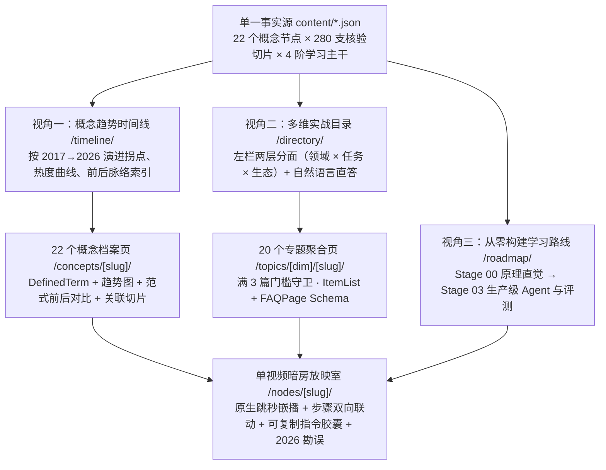

# AITube 三视角信息架构：概念趋势时间线 × 多维目录 × 学习路线

继承 Growthtube「去深层嵌套树、去满屏胶囊污染、零死胡同交叉筛选、单视频暗房跳秒放映台」的设计逻辑，AITube 针对 AI 领域范式迭代极快的特性，确立了 **「三视角并存、单一事实源驱动」** 的全站信息架构。

---

## 1. 全站路由与三视角协同关系

---

## 2. 核心创新：「概念趋势时间线索引视角」交互规范

### 2.1 顶部全景时代波纹导航（Era & Lifecycle Scrubber）
- **纪元锚点**：`全部纪元` · `2017–2022 奠基` · `2023 生成式爆发` · `2024 工具与多模态` · `2025 推理与协议` · `2026 上下文与技能工程`
- **趋势状态快筛**：
  - `🔥 爆发期 Surging`：近 12 个月工程检索与采纳陡升（如 `Context Engineering`、`Agent Skills`、`Agentic Coding CLI`、`RLVR`、`MCP`、`World Models`）
  - `🏛️ 主流基建 Mainstream`：已进入生产标配稳态（如 `Structured Outputs`、`LLM Evals`、`Hybrid RAG`、`LoRA & Ollama`、`ComfyUI`）
  - `📐 奠基常青 Foundational`：永不过时的底层必修直觉（如 `Transformer & Attention`、`Tokenization & Embeddings`、`Scaling Laws`）
  - `🔄 已演进迭代 Evolved`：历史关键跳板，但直接照搬旧做法容易踩坑，页面显式给出**演进后继指针**（如 `Prompt Tricks → Context Engineering`、`Vibe Coding → Agentic Coding Harnesses`、`Rigid Agent Chains → Agent Skills & Loops`）

### 2.2 单个概念时间线卡的四要素表达
1. **时间坐标与 10 季度热度微图谱（SVG Sparkline）**：左标 `诞生季度 → 爆发拐点`，右绘 `2022H2–2026Q3` 相对关注度折线与拐点高亮圆点，杜绝虚构绝对搜索量。
2. **Before → After 范式迁移批注**：用一句精炼对照讲清“以前怎么折腾 vs 现在怎么收敛”。
3. **前后谱系跳转链（Lineage Chain）**：点击 `← 前序概念` 或 `演进后继 →` 可在时间线上平滑定位或进入对应概念档案页 `/[lang]/concepts/[slug]/`。
4. **三支代表性切片直达（Origin · Practice · Frontier）**：直接在概念卡下方展示该概念最经典的 3 支精选时间窗切片，并附「查看本概念全部 N 支切片 →」。

---

## 3. 大规模内容（280+ 节点）下的性能与 SEO/GEO 契约

1. **首屏 SSR 24 张 + 客户端零延迟构造**：目录页首屏直出 24 张暗房声波卡，筛选、切换生命周期/短切片或点击「加载更多」时由客户端即时渲染，保证静态 HTML 轻量秒开。
2. **检索语料按语言解耦**：全局 `⌘K` 与目录页自然语言直答共享 `/search-corpus-zh.json` 与 `/search-corpus-en.json`，融合标题、步骤、2026 勘误、概念别名与真实问答句，不重复内联进每张 HTML。
3. **满 3 篇生成静态 Hub + 折叠全量账本**：概念页 `/concepts/[slug]/` 与分面专题页 `/topics/[dim]/[slug]/` 首屏展示最多 24 张画廊卡，超出部分收纳于原生 `
` 静态索引账本中，100% 保证全站 280+ 双语单视频页皆有真实静态内链可达。
