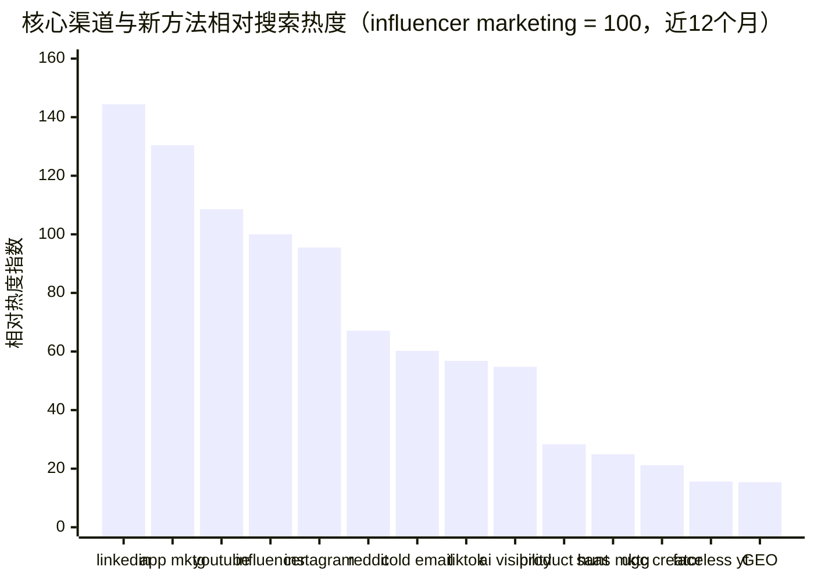
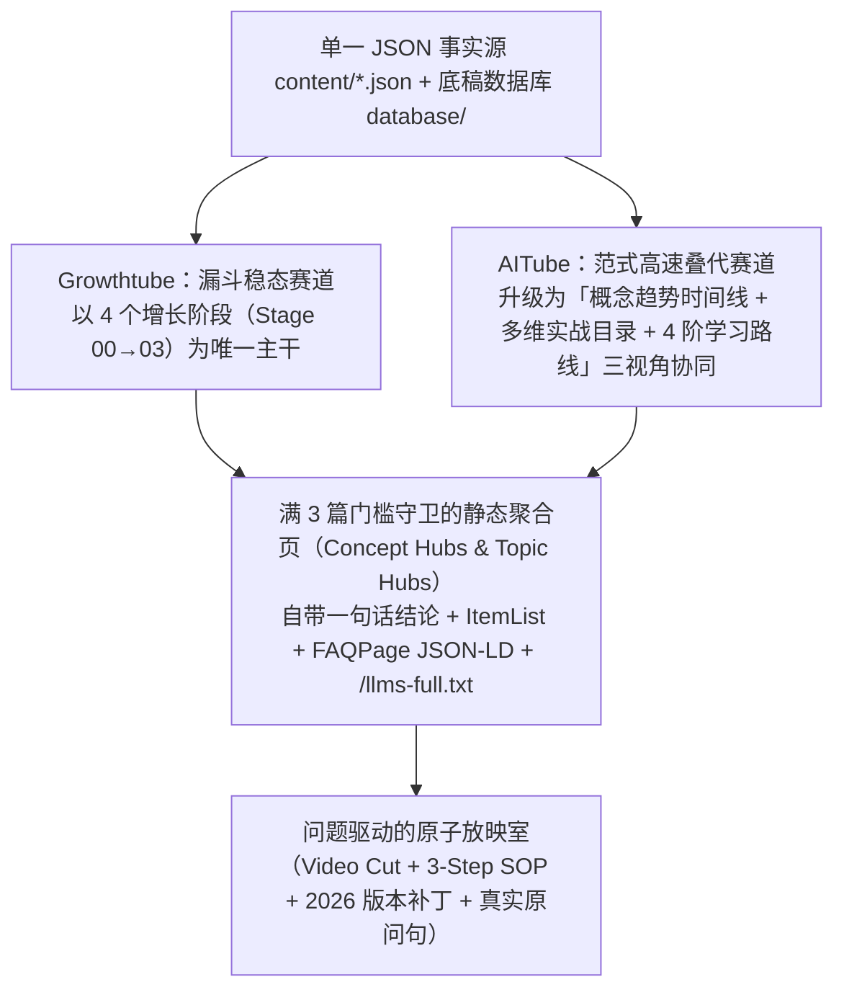

# Growthtube × AITube 基线研究：AI 搜索（AI SEO / GEO / AEO）与 Google 关键词趋势实证报告

**采集日期**：2026-11-12  
**研究归档说明**：本报告最初在姊妹项目 **Growthtube** 上完成实测，完整揭示了 **2025–2026 Google Trends 爬虫膨胀噪音过滤法**、**`AI SEO / GEO / AEO / AI Overviews / AI Mode` 搜索范式剧变**、**中英文检索词差（Vocabulary Gap）** 以及 **「一主干 + 三分面 Hub + 问题颗粒度视频切片」** 的底层内容组织逻辑，是 AITube 后续持续迭代概念时间线、SEO/GEO 落地页与新视频选题的**核心实证基座**。  
**配套原始数据集（已归档于本仓）**：
- [`datasets/growthtube_google_trends_5y.json`](datasets/growthtube_google_trends_5y.json)（21 组 Google Trends 5 年全球序列 + 日常生活去噪对照组 + 18 个核心词关联词与国家分布）
- [`datasets/growthtube_google_yt_suggest_367.json`](datasets/growthtube_google_yt_suggest_367.json)（367 组中英文 Google Web & YouTube 实时下拉联想原词）
- [`datasets/growthtube_baidu_suggest_69.json`](datasets/growthtube_baidu_suggest_69.json)（69 组中文百度实时下拉联想原词）

---

## 1. 数据来源与口径说明（不编造声明）

本报告所有结论均来自以下可复查的一手接口与公开研究，未使用任何未经核实的绝对月搜索量估算：

1. **Google Trends（通过 `pytrends` 实时拉取，全球 `geo=""`，时间窗 `today 5-y` 与 `today 12-m`）**：共采集 **21 组 5 年对比序列**、**18 个核心词的 12 个月 Top / Rising 关联词**、**4 个词的国家分布**。多组之间以 `influencer marketing` 作为统一锚点（Anchor = 100）做横向折算。
2. **Google Web Autocomplete 与 YouTube Autocomplete（`suggestqueries.google.com`）**：采集英文 `hl=en` 与中文 `hl=zh-CN` 共 **367 组**（首轮 298 组 + 增补 69 组）下拉联想词，代表真实高频输入句式。
3. **百度下拉联想（`suggestion.baidu.com`）**：采集 **69 个**中文出海 / 增长 / AI 搜索种子词的实时下拉词，弥补中国大陆用户因网络环境在 Google Trends 中文词上的样本缺失。
4. **第三方公开数据研究与平台官方数据**：
   - Semrush *AI Overviews Study*（2025-12-15，10M+ 关键词）：https://www.semrush.com/blog/semrush-ai-overviews-study/
   - Semrush *Commercial AI Overviews Study*（2026-07-02）：https://www.semrush.com/blog/ai-overviews-commercial-search-study/
   - Semrush *Reddit AI Search Visibility Study*（2025-11-10，24.8 万条 Reddit 帖子）：https://www.semrush.com/blog/reddit-ai-search-visibility-study/
   - Google Search Central *Optimizing your website for generative AI features*（2026-07）：https://developers.google.com/search/docs/fundamentals/ai-optimization-guide
   - Google 官方报告 *How People Are Using AI Mode in the U.S.*（经 Search Engine Journal 2026-07-02 摘录）：https://www.searchenginejournal.com/google-data-shows-ai-search-users-moved-past-keywords-your-content-hasnt/580596/
   - Practical Ecommerce 关键词搜索量多工具偏差对比（2024-11）：https://www.practicalecommerce.com/keyword-volume-google-vs-semrush-vs-ahrefs
   - Kickstarter 官方统计与 LaunchBoom / LaunchList 硬件预热转化率基准（2026-10 / 2026-11）：https://getlaunchlist.com/blog/kickstarter-email-list 、https://www.launchboom.com/crowdfunding-guides/kickstarter-advertising/
   - Reddit 真实创业者问答帖（`r/SaaS`、`r/microsaas`、`r/hwstartups`、`r/kickstarter`）。

> [!WARNING]
> **必须前置说明的三个数据局限与异常（我们在实测中抓到的噪音）**
> 1. **绝对搜索量不可信，只能看相对比值**：Practical Ecommerce 实测同一个词 `reddit marketing` 在美国月搜索量，Google Ads 报 **880,000**、Semrush 报 **590,000**、Ahrefs 报 **100,000**，相差近 9 倍。因此本报告不报虚构的“月搜 X 万”，统一使用 Google Trends **相对热度指数**。
> 2. **2025 下半年起 B2B / 科技 / 营销词在 Google Trends 存在系统性抬升（爬虫与排名监控污染）**：我们专门跑了对照组（`weather`、`recipe`、`calculator`、`translate`）。生活词近 5 年增长仅 **0.57×–1.21×**，而几乎所有行业词在 2025–2026 年都同步跳涨 **4×–12×**，同时关联词中混入 `walmart near me`、`hc andersen født` 等明显 SEO 爬虫探针词（`r/SEO` 与 Search Engine Land 2025-09/12 多篇报告已证实 AI 爬虫行为模拟激增 15×）。**因此单看某词“5 年涨 6 倍”可能是假象；必须看它相对于统一锚点词的份额变化（Share Gain），这才是真实冷热。**
> 3. **国家榜单的小样本极值与代理污染**：`reddit marketing`、`generative engine optimization` 的国家相对浓度第 1 名均显示为人口仅数千的 `St. Helena`，而 `China` 在英文词 `generative engine optimization`（指数 25 vs 美国 21）与 `reddit marketing`（指数 19 vs 美国 16）中冲进全球前 5——说明国内从业者检索英文专业词的密度极高，但中文词在 Google Trends 上总量远小于英文词，必须结合百度下拉交叉验证。

---

## 2. Google 趋势核心发现：他们到底在搜什么词？

### 2.1 跨维度总榜（以 `influencer marketing` 近 12 个月均值 = 100 折算）

下表将不同批次通过共同锚点 `influencer marketing` 归一到同一把尺子上，并用 **相对份额变化（Share Gain vs Anchor）** 剔除 2025–2026 爬虫基线膨胀（`> 1.0×` 代表真正在跑赢大盘，`0 → 有值` 代表近两年从零诞生的新词）：

| 维度分类 | 关键词（Google 全球原词） | 相对热度（Anchor=100） | 首 12 月原值 | 近 12 月原值 | 跑赢大盘倍数（vs Anchor） | 信号解读 |
| --- | --- | ---: | ---: | ---: | ---: | --- |
| 方法 | `email marketing` | **349.1** | 2.9 | 18.5 | 1.20× | 体量最大，近 3 月冲高至 35.5 |
| 方法 | `content marketing` | **167.9** | 2.0 | 8.9 | 0.84× | 基本盘大，份额小幅回落 |
| 平台 | `linkedin marketing` | **144.4** | 5.3 | 35.1 | 1.06× | ToB 社媒第一大词，稳步扩张 |
| 产品品类 | `app marketing` | **130.4** | 4.0 | 49.3 | **1.96×** | **移动 App 获客需求翻倍跑赢大盘** |
| 平台 | `youtube marketing` | **108.6** | 3.2 | 26.4 | **1.32×** | 长视频评测与教程持续走强 |
| 方法（锚点） | `influencer marketing` | **100.0** | 7.4 | 46.2 | 1.00× | 红人营销主词，体量稳居一线 |
| 平台 | `instagram marketing` | **95.5** | 4.8 | 23.2 | 0.78× | 体量大但增速慢于 TikTok / Reddit |
| 方法 | `affiliate marketing` | **92.5** | 3.3 | 4.9 | 0.28× | 老牌大词，增长趋于饱和 |
| 硬件/众筹 | `kickstarter` | **87.2** | 34.5 | 40.3 | 0.19× | 硬件众筹成熟稳态盘，无虚火 |
| 平台 | `reddit marketing` | **67.1** | 2.2 | 28.0 | **1.98×** | **增速并列第一，AI 引用红利直接推高** |
| 方法 | `cold email` | **60.2** | 3.4 | 27.8 | **1.31×** | B2B 冷邮件需求强劲 |
| 模式 | `b2b marketing` | **58.5** | 5.9 | 22.1 | 0.59× | 泛词，用户正转向更具体的渠道词 |
| 平台 | `tiktok marketing` | **56.8** | 1.1 | 13.8 | **2.01×** | **增速第一的社媒平台词** |
| AI 搜索 | `ai visibility` | **54.8** | 0.0 | 25.3 | **新词爆发** | 比学术词 GEO 更大众的商业表达 |
| 硬件/电商 | `amazon fba` | **41.3** | 17.0 | 19.1 | 0.18× | 跨境亚马逊成熟盘 |
| 产品品类 | `ecommerce marketing` | **34.4** | 2.6 | 13.0 | 0.79× | 独立站/电商泛词 |
| 平台/发布 | `product hunt` | **28.3** | 1.3 | 11.8 | **1.41×** | AI 工具发布潮带动回升 |
| 产品品类 | `saas marketing` | **24.9** | 1.0 | 9.4 | **1.49×** | SaaS 增长跑赢大盘近 50% |
| AI 搜索 | `ai overviews` | **23.6** | 0.0 | 10.9 | **新词爆发** | Google AIO 上线后的高频痛点词 |
| 方法 | `ugc creator` | **21.2** | 0.5 | 9.8 | **新词爆发** | 替代昂贵大 V 的素人短视频模式 |
| 矩阵/无脸 | `faceless youtube` | **15.6** | 0.0 | 7.2 | **新词爆发** | 海外版“矩阵/无人出镜号”第一热词 |
| AI 搜索 | `generative engine optimization` | **15.4** | 0.0 | 7.1 | **新词爆发** | 2025 起步，2026 涨 3.5× |
| 平台 | `twitter marketing` | **12.2** | 2.2 | 5.1 | 0.36× | 改名 X 后词形分裂，搜索走弱 |
| AI 搜索 | `chatgpt seo` | **10.2** | 0.0 | 4.7 | **新词爆发** | 实操派更爱搜的直白词 |
| 矩阵/无脸 | `ugc ads` / `faceless tiktok` / `multiple tiktok accounts` | **5.6 / 3.9 / 2.6** | 0.0 | 2.6 / 1.8 / 1.2 | **新词爆发** | 英文用户不搜“matrix”，搜这组词 |
| 方法 | `programmatic seo` | **2.6** | 0.0 | 1.2 | 小众高价值 | 词量小但客单价与商业意图极高 |
| 硬件/寄样 | `product seeding` / `consumer electronics marketing` | **1.7 / 1.3** | 0.0 | 0.8 / 0.6 | 行业术语窄 | **重要反直觉发现：从业者极少搜行业泛词，见 2.4** |

### 2.2 AI 搜索（GEO / AEO / AI SEO）内部词形之争：用户搜哪个？

同一批 5 年对比（`cmp5y::ai_search`）+ `cmp5y::ai_answers` 显示，**从业者造的缩写词远不如“AI + SEO / Visibility”直白词搜索量大**：

| 同批次对比词（`cmp5y::ai_search`） | 2023 | 2024 | 2025 | 2026 | 近 12 月均值 | 结论 |
| --- | ---: | ---: | ---: | ---: | ---: | --- |
| `ai seo` | 4.2 | 6.8 | 28.5 | **60.6** | **57.7** | **绝对统治词（是 GEO 的 6 倍）** |
| `ai search optimization` | 0.0 | 0.0 | 3.3 | **11.0** | **10.1** | 第二顺位通用词 |
| `generative engine optimization` | 0.0 | 0.0 | 3.0 | **10.3** | **9.5** | 圈内标准术语，必须双写覆盖 |
| `answer engine optimization` | 0.0 | 0.0 | 1.6 | **5.9** | **5.4** | 约为 GEO 的一半 |
| `llm seo` | 0.0 | 0.0 | 1.5 | **3.7** | **3.5** | 偏技术向小众词 |

而在中文 Google Trends 独立批次（`cmp5y::zh_only_b`）里出现了相反现象：**`GEO优化`（2026 年均值 37.2）远高于 `独立开发`（18.7）、`TikTok运营`（15.0）、`谷歌SEO`（3.3）与 `SaaS出海`（1.6）**。百度与 Google 中文下拉显示，这是因为国内大量技术与营销团队在 2025–2026 集中推“GEO优化系统 / 源码 / 服务商”，把 `GEO优化` 推成了中文第一标准词。  
**落地启示**：英文标题与元数据必须优先覆盖直白词 + 标准词双写（如 `AI SEO & GEO`），中文则用本土高共识词，绝不做机械直译。

### 2.3 用户不按“抽象方法论”搜，更多按「问题目标」和「具体载体」搜

在目标批次（`cmp5y::goals`）与阶段批次（`cmp5y::stage`）中：

- **目标词对比（近 12 个月均值）**：`how to get users`（**43.7**）≈ `how to get customers`（**41.7**） >> `how to market an app`（**15.5**，但 5 年涨 11×） >> `how to get traffic to website`（**5.6**） > `how to promote my business`（**2.4**）。
- **阶段词对比（近 12 个月均值）**：`product launch`（**34.3**）与 `waitlist`（**28.8**）遥遥领先；而圈内高频黑话 `build in public`（**6.8**）、`product market fit`（**1.8**）、`go to market strategy`（**1.3**）在大众搜索里占比很低。
- **同一定律在 AITube 同样复现**：普通学习者不会搜“Autoregressive Token Sampling”，他们搜的是 *“大模型到底是怎么猜出下一个词的”*、*“为什么跟 AI 聊久了它就变笨乱改代码”*——这也是 AITube 全面推行「讲人话标题 + 场景快筛」的实证根源。

### 2.4 两个极具代表性的「词差（Vocabulary Gap）」案例

1. **做 3C / 硬件的人，几乎不搜 `how to market electronics` 或 `3C产品海外推广`**：
   - 在 Google 英文下拉里输入 `how to market electronics`，前 10 条联想词全部滑向二手售卖（`on ebay / for cash`）。在百度搜 `3c出海` 甚至混入魔兽地图 `3C澄海`；搜 `硬件出海` 全是 A 股概念股。
   - 真正的从业者按**具体动作链**搜：`kickstarter pre launch page`、`product seeding strategy`、`how to get youtubers email`、`amazon listing optimization`。
2. **中英文对“矩阵”的叫法完全不同**：
   - **中文世界**直接搜 `tiktok矩阵管理系统`、`矩阵运营指纹浏览器`；
   - **英文世界**完全不搜 `account matrix`，他们搜 **`faceless youtube`**、**`multiple tiktok accounts on one device`**、**`reddit account warmup`**。

### 2.5 搜索行为本身的底层剧变（为什么「精选视频切片 + 3 步 SOP + 结构化问答」正踩在红利上）

- **AI Overviews 已深度渗透高价值技术与商业词**：Semrush 追踪 10M+ 词显示，Google AI Overviews 在商业调研意图词的占比从 8.15% 升至 **18.57%**，其中 **Computers & Electronics 暴涨 +107.62%**。同时 **90%** 的 AIO 结果页伴随 People Also Ask（PAA）问答框，并高频并列展示 **YouTube 视频轮播与 Reddit 讨论帖**。
- **精准回答细分问题的长尾内容长期霸占 AI 引用位**：Semrush 分析 24.8 万条 Reddit 帖子发现，Reddit 在 Perplexity 引用源排 **第 1**、ChatGPT Search 排 **第 2（约 13% 回答）**、Google AI Mode 排 **第 3（9%）**；超半数被引用帖是 **Q&A 问答帖**，且 **80% 被引用帖点赞数不足 20、平均帖龄约 900 天**——证明精准、结构化回答具体真问题的内容生命力极长。
- **用户查询长度翻了 3 倍，从“敲关键词”变成“带背景提问”**：Google 官方 AI Mode 年度数据（全球月活超 10 亿）披露，AI Mode 平均查询长度是传统搜索的 **3 倍**，追问率月均增长 **40%+**，`"which"` 开头的决策对比词增速快 **40%**，最常见的 5 个开场词是 **`what`、`how`、`I`、`is`、`can`**。

---

## 3. 从 Growthtube 到 AITube 的内容组织架构传承

正是基于上述实证，Growthtube 与 AITube 确立了同源但因地制宜的 **「主干视角 + 正交分面 Hub + 问题颗粒度原子节点」** 架构：

1. **满 3 篇才生成静态聚合页（Anti-Thin-Content Gate）**：任何分面标签必须攒够 `>= 3` 个高质量节点才生成独立 `/topics/.../` 页面，在 [`scripts/validate-content.mjs`](../scripts/validate-content.mjs) 中强制守卫。
2. **原子节点沉淀真实用户原问句（`searchQuestions`）**：每条节点固定收录 2–3 条来自 Google / YouTube / 百度下拉框的真实长尾问句，同时驱动站内 `<50ms` 直答搜索、底部常见问题结构化数据与 `/llms-full.txt`。
3. **双轨词形覆盖**：英文与中文独立撰写符合各自母语搜索直觉的标题、副标题与同义词表，绝不机械互译。
